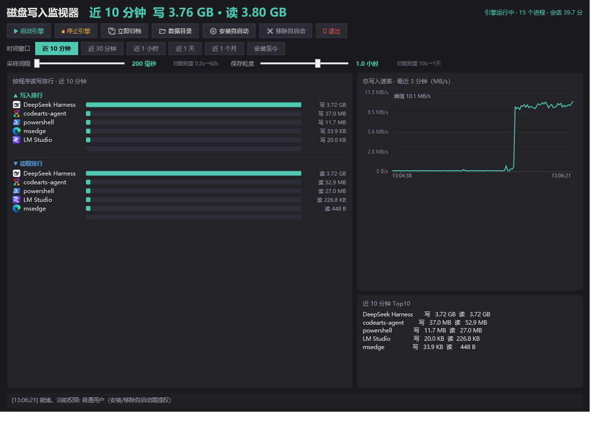
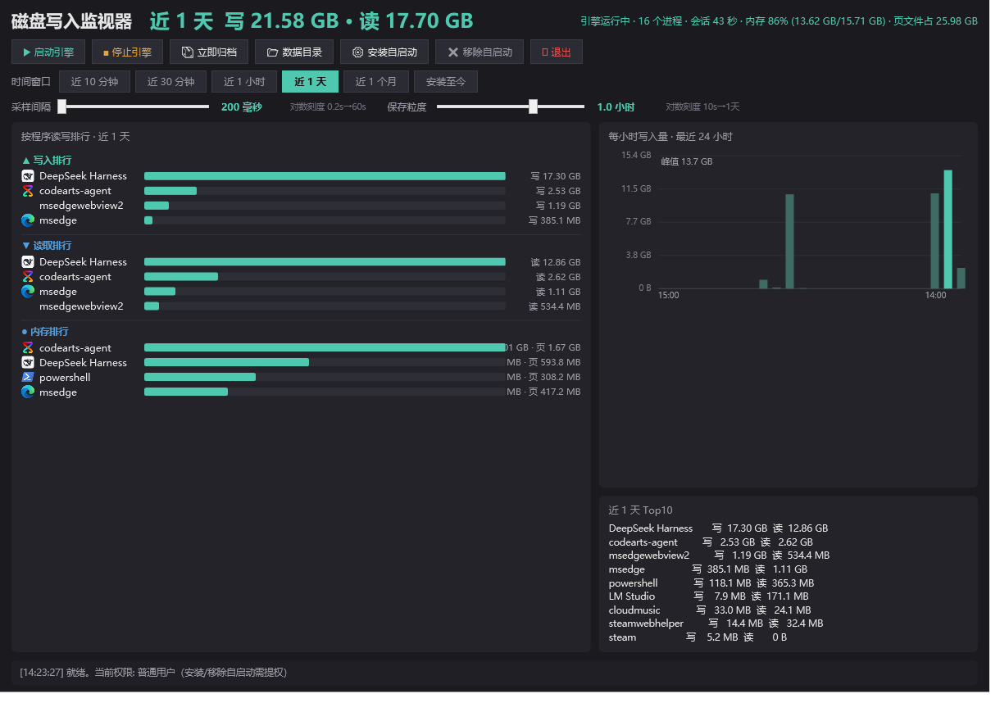

# 磁盘读写监视器 · DiskWriteMonitor

一个 100 KB 出头的 Windows 小工具：**按软件统计磁盘读写量，能回看任何时间点，数据量每天只有几十 KB。**

任务管理器只能看“现在”，资源监视器关掉就没了，性能监视器能记录但配置麻烦、日志很大。这个工具补的是中间那一段：打开就看、历史自动存、按软件合并、几乎不占磁盘。

## 为什么需要它

真实场景：某天 C 盘突然少了 216 GB。任务管理器上看不到任何东西——那些写入早就结束了。

```
C:\BootTrace\...WPR_System_Collector.etl.003   144.57 GB   17:38 → 21:13
C:\BootTrace\...WPR_System_Collector.etl.002    58.11 GB   11:40 → 14:28
```

事后只能靠文件时间戳倒推。有了历史记录，直接就能回答“昨天下午谁在写盘”。

## 截图



近 1 天视图（趋势图自动切成按小时的柱状，左侧刻度变成 GB）：


## 功能

| 能力 | 说明 |
|---|---|
| 按软件聚合 | 同一程序的多进程/多标签合并成一条，名字前带程序图标 |
| 读写分开 | 写入排行和读取排行各自独立排序 |
| 内存 + 页文件 | 按软件看工作集和页文件占用（swap），顶栏显示物理内存 / 提交 / 页文件 |')
| 六个时间窗口 | 近 10 分钟 / 30 分钟 / 1 小时 / 1 天 / 1 个月 / 安装至今 |
| 历史自动保存 | 关机/退出自动封账，重启后照常查询 |
| 存储极省 | 粒度 1 小时约 **20 KB/天**，粒度 10 分钟约 120 KB/天 |
| 双滑块 | 采样间隔 0.2s～60s、保存粒度 10s～1 天，对数刻度，改完即时生效 |
| 后台常驻 | 登录自启、单实例、心跳自愈；关窗口只最小化，采集不断 |
| 自动归档 | 旧数据压缩进 `archive\`，可按保留月数清理 |

## 快速开始

1. 下载 `DiskWriteMonitor.exe`（Release 里）
2. 双击 → 打开看板
3. 想要开机自启：`DiskWriteMonitor.exe --install`

不需要安装、不需要管理员权限、不写注册表（自启动走计划任务/启动文件夹）。

## 界面

```
┌─────────────────────────────────────────────────────────┐
│ 磁盘写入监视器   近 10 分钟  写 1.2 GB · 读 3.4 GB        │
│ [▶启动] [■停止] [📦归档] [📂目录] [⚙自启] [✖移除] [⏻退出] │
│ 时间窗口: [10分钟][30分钟][1小时][1天][1个月][安装至今]   │
│ 采样间隔 ————●————  保存粒度 ———●—————                    │
│ 引擎运行中 · 412 个进程 · 会话 12m · 内存 85% (13.2/15.7 GB) │
├──────────────────────────┬──────────────────────────────┤
│ ▲ 写入排行                │  总写入速率 · 最近 3 分钟     │
│ [icon] msedge    12.3 MB │  13.0 MB/s ┤                 │
│ [icon] chrome     4.1 MB │   9.7 MB/s ┤      ╭─╮        │
│ ...                      │   0 B/s    └──────────────    │
├──────────────────────────┼──────────────────────────────┤
│ ▼ 读取排行                │  窗口内 Top10                │
│ [icon] chrome    88.2 MB │  chrome  写 4 MB 读 88 MB     │
│ ...                      │                              │
├──────────────────────────┤                              │
│ ● 内存排行                │                              │
│ [icon] chrome   3.1 GB · 页 1.2 GB                        │
│ [icon] msedge   1.4 GB · 页 968 MB                        │
└──────────────────────────┴──────────────────────────────┘
```

## 命令行

```
DiskWriteMonitor.exe               打开看板
DiskWriteMonitor.exe --engine      后台采集（计划任务用）
DiskWriteMonitor.exe --autostart   开机自启（引擎 + 面板）
DiskWriteMonitor.exe --tray        只以隐藏方式启动界面
DiskWriteMonitor.exe --install     安装自启动
DiskWriteMonitor.exe --uninstall   移除自启动
DiskWriteMonitor.exe --status      查看自启动与引擎状态
DiskWriteMonitor.exe --archive     立即执行一次归档
DiskWriteMonitor.exe --stop        停止引擎
DiskWriteMonitor.exe --version     版本信息
```

加 `--no-ui` 把结果写进 `data\cli.out.log`，便于脚本调用。

## 数据是怎么存的

```
1 秒采样 ──┬─► 环形缓冲（内存，60 分钟）──────► 10min / 30min / 1h 窗口
           └─► 当前桶（内存）──走完一个保存粒度──► buckets\*.json ──► 1天 / 1个月
                              └──每次封桶累加──► lifetime.json ──► 安装至今
```

内存里只保留最近 1 小时，超过的部分全部落盘。所以**内存占用是常数**，开机 5 天和 5 个月一样。

```
data\
  state.json             看板快照（约 5 KB）
  buckets\*.json         封口的桶，一个粒度一个文件（约 0.3 KB）
  lifetime.json          安装至今累计
  current-session.json   当前会话检查点（覆盖写，大小恒定）
  sessions\*.json        会话封账记录
  engine.heartbeat       心跳（能区分"卡住"和"进程已死"）
  engine.log / engine.out.log / launcher.log
archive\
  buckets\yyyy-MM\       超过保留天数的桶，压缩存放
```

## 配置（config.json）

| 键 | 默认 | 说明 |
|---|---|---|
| `sampleIntervalMs` | 1000 | 采样间隔（界面滑块控制） |
| `persist.granularitySec` | 3600 | 保存粒度（界面滑块控制） |
| `persist.flushSec` | 300 | 检查点落盘频率，决定断电最多丢多少秒 |
| `archive.olderThanDays` | 30 | 多少天后压缩归档 |
| `archive.keepMonths` | 6 | 归档保留月数 |
| `archive.watchFolders` | `[]` | 额外要自动归档的旧文件目录 |

## 内存与页文件（swap）

磁盘读写只说明「谁在写盘」，说明不了「为什么」。某款软件把内存挤进页文件时，盘上会出现大量写入，而这些写在任务管理器里挂在 System 名下。

所以榜三是内存榜，口径和任务管理器一致：

| 指标 | 来源 | 说明 |
|---|---|---|
| 工作集 | `GetProcessMemoryInfo` → `WorkingSetSize` | 实际占着的物理内存 |
| 页文件 | `GetProcessMemoryInfo` → `PagefileUsage` | 被换到页文件的部分，即这个软件的 swap |
| 内存负载 | `GlobalMemoryStatusEx` | 系统百分比 |
| 提交 | `GlobalMemoryStatusEx` | 已承诺的内存；超过物理的部分由页文件扛 |

按**程序名**把多进程/多标签相加，和读写榜同一口径。

进程内存是**瞬时值**，只保留当前快照，不进历史桶——历史只累计读写，否则存储量会失控。


## 刷新节奏

界面刷新跟着采样走，不是固定间隔：

| 采样间隔 | 看板打开时更新间隔 |
|---:|---:|
| 1000 ms | ≈1 秒 |
| 200 ms | ≈0.5 秒（受限于进程枚举本身的耗时） |

没有看板打开时，引擎把发布频率降到 30 秒一次，避免监控工具自己狂写盘。

## 从源码构建

需要 Windows 自带的 .NET Framework 编译器（`csc.exe`），无需 Visual Studio：

```powershell
.\build.ps1
```

或手动：

```powershell
csc /target:winexe /optimize+ /out:DiskWriteMonitor.exe /win32icon:src\app.ico `
  /resource:DiskWriteMonitor.ps1,EngineScript `
  /resource:DiskWriteDashboard.ps1,DashboardScript `
  /resource:Install-Autostart.ps1,InstallerScript `
  /resource:config.default.json,DefaultConfig `
  /resource:src\app.ico,AppIcon `
  /reference:System.Windows.Forms.dll /reference:System.Drawing.dll `
  src\Launcher.cs src\AssemblyInfo.cs
```

> 注意：`.ps1` 必须是 **UTF-8 with BOM**，否则 Windows PowerShell 5.1 会把中文读成乱码并报语法错。

## 已知限制

- 普通权限下约 20–40 个系统进程读不到（任务管理器也是同样限制）；内存同理，受保护进程取不到工作集
- 托盘图标在部分系统上会被收进「^」溢出区，本工具不依赖托盘：关窗口是最小化到任务栏
- 采样下限约 0.4 秒，瓶颈是每次枚举几百个进程并逐个 `OpenProcess`
- 只支持 Windows

## 持续集成

`.github/workflows/build.yml` 会在每次 push 到 main 时用 `windows-latest` 的 `csc.exe` 编译并上传产物；打 `v*` tag 时自动附到 Release。

## 许可

MIT
